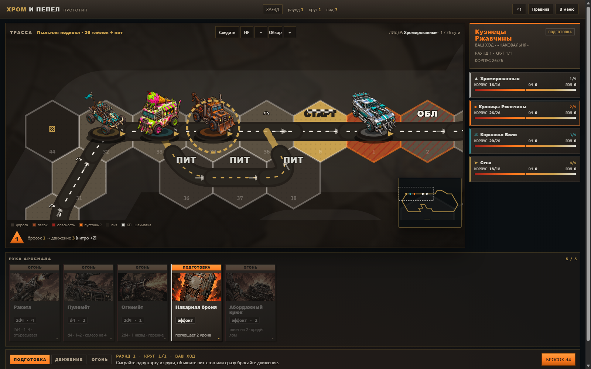
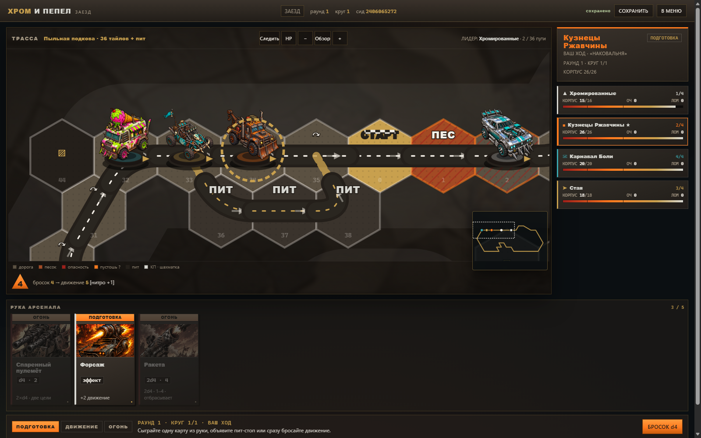

# CHROME & ASH · ХРОМ И ПЕПЕЛ

A post-apocalyptic **hex-mosaic racing board game that builds its own track** — with a playable browser prototype, a Node web client, and online PvP.




## What it is

- **4 asymmetric factions** — Chrome cultists, Rust mechanics, the Carnival of Pain, and the Swarm. Each has its own car, HP, slots and ability.
- **The track is a mosaic, not a ring.** Hex tiles carry road ports A–F; you assemble a closed loop from 36 main tiles + 3 pit tiles + 10 buildings. Turns are 60°/120°, with a hairpin, a chicane, a bridge, a tunnel and a pit lane.
- **Race and combat are the same action.** Movement, ramming, rockets, mines, oil and fire all compete for the same turn.
- **22 arsenal cards, 15 workshop upgrades, 9 wasteland events.** Two modes: a single race or a 3-race championship with a workshop between races.
- **Digital prototype** (browser, no server) + **web version** with accounts, cloud saves, a daily seed with a leaderboard, and **PvP** (WebSocket lobbies, hidden hands, 90 s turn timer, reconnect, bot takeover).
- **Readable-by-design UI**: follow camera, minimap, phase strip, colour-coded miniatures, HP on hover/toggle.
- **AI-generated art**: car minis and 22 card illustrations generated with Yandex ART and BotHub `gpt-image-2`, integrated as SVG/CSS-friendly assets.

## Play

### Static prototype (no server)

Open `chrome-and-ash/index.html` — or the single-file build `chrome-and-ash/dist/chrome-and-ash.html` (keep `dist/assets/` next to it).

### Web version (Node 24+)

```bash
cd server
npm install
npm start
# http://127.0.0.1:3000
```

### PvP

Open the web version in two browsers, register two accounts, create a lobby and join by its code. Empty slots are filled by AI. The server is authoritative; hands are hidden per player.

## Repository layout

```
chrome-and-ash/        board-game prototype (vanilla JS + SVG) and design docs
chrome-and-ash-web/    web client (same engine, auth/lobby/save/leaderboard, PvP)
server/                Node 24 + Express + node:sqlite, REST API and WebSocket PvP
```

## Docs

- `chrome-and-ash/docs/01-review.md` — design audit and proposed extensions
- `chrome-and-ash/docs/02-prototype-rules.md` — prototype rules
- `chrome-and-ash/docs/03-balance-report.md` — simulation report
- `chrome-and-ash/docs/04-hex-track-layout.md` — hex grammar and track assembly
- `chrome-and-ash/docs/05-art-brief-sunset-readability.md` — art/readability brief
- `chrome-and-ash-web/docs/06-web-api.md` — web API contract
- `server/docs/07-pvp-protocol.md` — PvP wire protocol

## Tests

```bash
cd server && node --test          # 28 tests
node chrome-and-ash-web/verify.mjs  # 29 checks
node chrome-and-ash/tests/mosaic.js 100
node chrome-and-ash/tests/report.js 600 150
```

## Art & license

Car minis and card illustrations are AI-generated for this project (Yandex ART + BotHub `gpt-image-2`). Code and game design are MIT licensed — see `LICENSE`.
