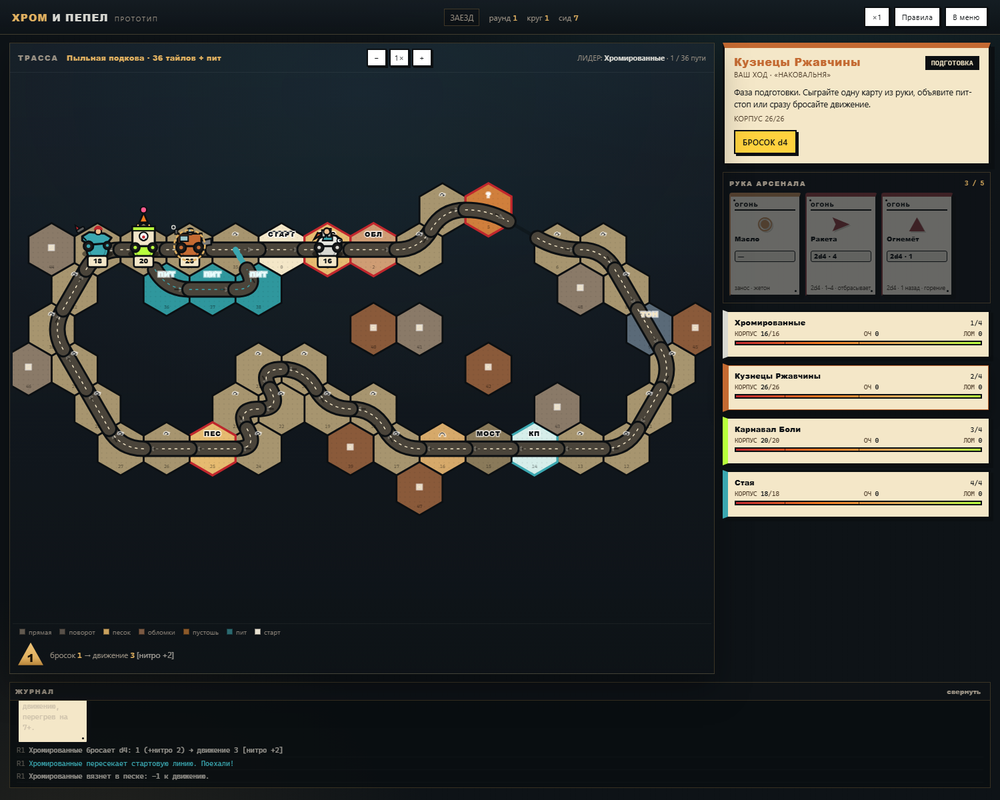
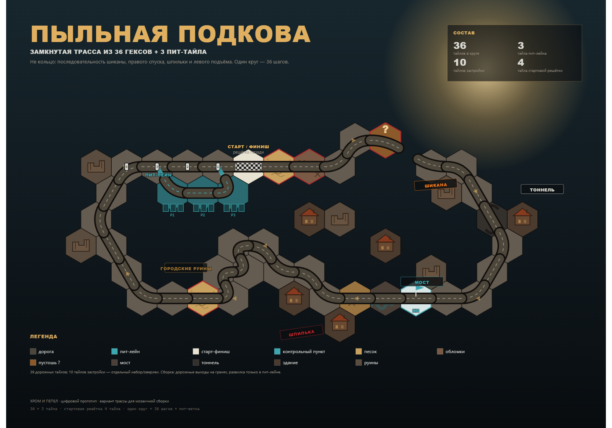

# ХРОМ И ПЕПЕЛ — цифровой прототип

Играбельный прототип настольной карточной гонки на выживание по дизайн-документу от 24 сентября 2026.
Один человек против трёх ИИ: трасса из гексов, d4-движение, арсенал, мины, таран, уничтожение без выбывания, чемпионат на три гонки с мастерской.





## Быстрый старт

1. Откройте **`index.html`** двойным щелчком. Интернет не нужен, всё локально.
2. Или соберите дистрибутив (`node build.mjs`) и откройте **`dist/chrome-and-ash.html`** — CSS/JS инлайн, арт лежит рядом в **`dist/assets/`** (фоны, портреты фракций, рубашки карт). Чтобы передать другу, отправляйте пару «`dist/chrome-and-ash.html` + `dist/assets/`».
3. Выберите режим, фракцию, трассу и нажмите «Выехать на трассу».

> Если браузер блокирует локальные скрипты, запустите из папки проекта:
> `python -m http.server 8000` и откройте `http://localhost:8000`.
> Обычно Chrome/Edge/Firefox открывают `index.html` с диска без сервера.

## Что реализовано

- 4 фракции с разными корпусами, слотами и способностями.
- 91 карта арсенала (22 типа: 14 базовых + 8 расширения), 15 улучшений, 9 событий Пустоши.
- Две трассы: мозаичная «Пыльная подкова» (36 гексов + 3 пит-тейла + 10 застройки) и старое кольцо на 28. Выбор в меню.
- Ход: подготовка → движение d4 → огонь. Шикана, шпилька, пит-лейн, трамплины, заносы, песок, обломки, тоннели, мосты.
- Мины, масло, огонь, обломки; лимит 3 активных мин.
- Уничтожение с возвратом на контрольный пункт, щитом и потерей карты/лома.
- Чемпионат из 3 гонок, очки, лом, мастерская с витриной, ИИ-покупки.
- ИИ-эвристики: готовка, выбор маршрута, цели, ловушки, апгрейды.
- Одностраничная сборка `dist/chrome-and-ash.html` (CSS/JS инлайн) + `dist/assets/` с артом рядом.
- Комикс-тема: толстая обводка, плоские цвета, мультяшные машины-стойки; зум доски − / + / 1×.
- Симулятор для прогонов баланса и отчёт по 600 гонкам.

## Управление

- Клик по карте в руке — сыграть; затем выбрать цель или тайл.
- «Бросок d4» — движение; на развилке или пит-лейне выбрать маршрут.
- «Завершить ход» — пропустить огонь; «Пит-стоп» — на пит-лейне.
- `Esc` — закрыть окно; `Space` — бросок d4; кнопка `×1/×2/×3` — скорость ИИ.
- «Правила» — справка; «В меню» — выход.

## Что показали проверка и симуляции

Полный аудит: [`docs/01-review.md`](docs/01-review.md). Отчёт по балансу: [`docs/03-balance-report.md`](docs/03-balance-report.md). Мозаичная трасса: [`docs/04-hex-track-layout.md`](docs/04-hex-track-layout.md).

Главные находки:

| Находка | Цифры |
|---|---|
| В документе нет движка добора карт, а цель 40–55% стрельбы без него недостижима | без добора 19% ходов с огнём и 1,58 уничтожения; с добором 1 карты — 38% и 4,79 |
| 94% гонок заканчиваются одним финишёром — очки за 2–4 места почти не работают | 94% / 1 финишёр, 6% / 2 финишёра |
| Два круга с добором превращаются в deathmatch | 40,6 хода на игрока, 17,65 уничтожения |
| Кузнецы Ржавчины доминируют, Хромированные слабы | 37% / 41% титулов против 16% / 13% |
| Среднее движение ниже заявленного | 2,22 тайла вместо 2,5–3,5 |
| Мозаичная трасса меняет темп | 47 ходов/гонку, 1,10 финишёра, 3,3 уничтожения, 34% огня — мягче кольца |

В прототипе эти проблемы не «спрятаны»: правила зафиксированы явно, а спорные места перечислены во вкладке «Правила → Отличия прототипа».

## Структура

```
chrome-and-ash/
├─ index.html                  запуск игры
├─ css/style.css               оформление
├─ js/data.js                  фракции, карты, улучшения, события, тайлы
├─ js/track.js                 трассы: кольцо и мозаичная подкова
├─ js/engine.js                правила, бой, экономика, чемпионат
├─ js/ai.js                    эвристики ИИ
├─ js/ui.js                    интерфейс
├─ build.mjs                   сборка dist/ (chrome-and-ash.html + assets/)
├─ dist/chrome-and-ash.html    игра одним файлом (CSS/JS инлайн)
├─ dist/assets/                арт рядом с html (bg/, factions/…/portrait.png)
├─ docs/01-review.md           аудит дизайна и расширения
├─ docs/02-prototype-rules.md  правила прототипа
├─ docs/03-balance-report.md   отчёт по балансу
├─ docs/03-balance-report-generated.md  машинная таблица
├─ docs/04-hex-track-layout.md  мозаичная трасса и грамматика гексов
├─ docs/hex-track.svg / .png    карта «Пыльной подковы»
├─ docs/hex-tiles.svg / .png    грамматика гекса
├─ tests/report.js             симулятор + отчёт
├─ tests/variants.js           сравнение конфигураций
├─ tests/batch.js              быстрый пакетный прогон
├─ tests/smoke.js              дымовой тест
├─ tests/mosaic.js             прогон мозаичной трассы
└─ screenshots/                скриншоты
```

## Симуляции

```bash
node tests/report.js 600 150     # 600 гонок на конфигурацию + 150 чемпионатов
node tests/variants.js 400       # сравнение балансных вариантов
node tests/batch.js 300 race 1   # быстрый прогон
node tests/smoke.js 12345        # одна гонка с логом
node tests/mosaic.js 300        # мозаика «Пыльная подкова»
```

Скрипт `report.js` перезаписывает `docs/03-balance-report-generated.md`.

## Ограничения v0.1

- Только 1 человек + 3 ИИ; hot-seat нет.
- Сборка трассы игроками не реализована: есть два сценария — мозаика и кольцо.
- Нет ночи, погоды, режима «Последний на колёсах» и правил на 2–3 игроков — предложения в обзоре.
- Реакции (Глушилка, таранный отвал) автоматические; окна реакции нет.
- Прогресс не сохраняется; каждая сессия начинается заново.
- Баланс — предмет плейтеста, а не финальная истина.

## Следующие шаги

1. Выбрать темп карт: «редкий арсенал» или «свинцовый дождь» (раздел 7 обзора).
2. Ввести очки за итоговую классификацию, иначе DNF = 0 делает чемпионат лотереей.
3. Привести корпус к формуле «база + 4 за слот» и протестировать 2 круга.
4. Сделать PnP «Пыльной подковы» на 24–30 тайлов и 2 фракции, провести слепой тест рулбука.
5. Только после этого — арт и производство.

---

Сделано в DeepSeek Harness. Дизайн-документ — исходный материал; прототип не является финальным продуктом.
