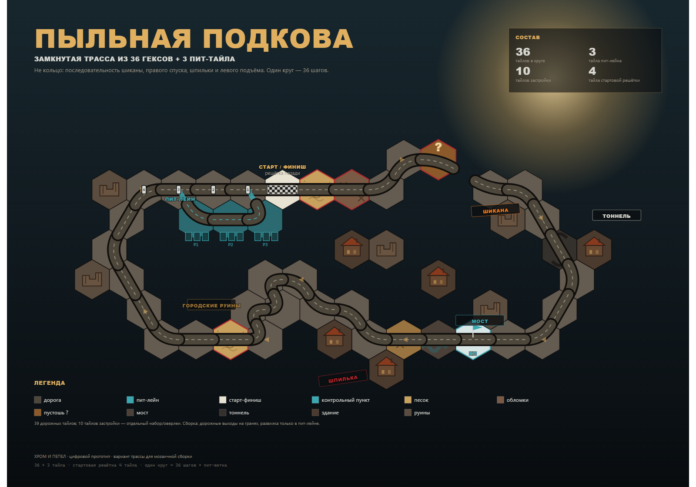
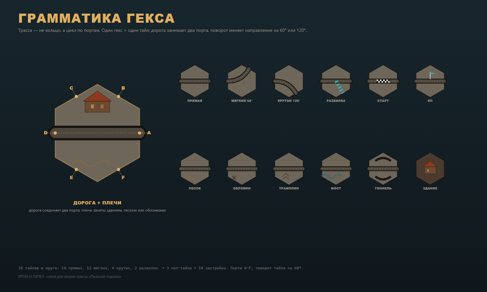

# Мозаичная трасса: «Пыльная подкова»

**39 дорожных тайлов: 36 в круге + 3 пит-лейна. Плюс 10 тайлов застройки/руин.**
Один круг — 36 шагов; стартовая решётка — 4 тайла позади линии; контрольный пункт — на нижней прямой.

---

## 1. Главная поправка: трасса — это не кольцо

Гексагональная мозаика не обязана быть кругом. Трасса — это **замкнутый цикл в графе дорожных выходов**:

- каждый гекс — узел;
- дорога выходит через середины граней (порты);
- два соседних гекса соединяются, только если на общей грани есть дорога с обеих сторон;
- машина едет по дороге, а не «по прямой к следующему гексу»;
- форма может быть любой: подкова, восьмёрка, змея, городской квартал.

Кольцо в первом прототипе было упрощением: оно проверяло темп, но не мозаику. Здесь трасса собрана как реальная последовательность поворотов: стартовая прямая, шикана, правый спуск, тоннель, мост, шпилька, левый подъём и возврат к старту.

---

## 2. Грамматика гекса

### 2.1. Порты

У гекса шесть граней. Назовём их **A–F** по часовой стрелке. Дорога выходит в середину грани. Тайл можно поворачивать на 60°, поэтому важно не «верх/низ», а **набор занятых портов** и **связь между ними**.

| Тип | Порты | Геометрия | Пример |
|---|---|---|---|
| Прямая | A–D | противоположные | стартовая прямая, мост |
| Мягкий поворот | A–B | соседние, 60° | правый спуск |
| Крутой поворот | A–C | через один, 120° | шпилька |
| Развилка/пит-вход | A–B–D | 3 порта | вход и выход пит-лейна |
| Пустой | — | нет дороги | здание, руины, скалы |
| Старт-финиш | A–D | прямая + разметка | линия старта |
| Контрольный пункт | A–D | прямая + флаг | КП на нижней прямой |
| Пит-лейн | A–D | прямая + боксы | три тайла в ряд |

**Правило стыковки:** если на общей грани двух гексов с одной стороны есть дорога, а с другой нет — стык запрещён. Если дорога есть с обеих сторон — она непрерывна. Поворот тайла меняет, какие порты смотрят на соседей.

### 2.2. Что печатается на тайле

- Дорожное полотно с двумя выходами (обычно).
- Обочина: песок, обломки, «?», трамплин.
- Здание/руины на свободной части гекса — блокируют линию огня, но не дорогу.
- Мост через сухое русло (одна дорога) или путепровод (две дороги на разных уровнях).
- Тоннель: дорога проходит под скалой/эстакадой, стрельба дальше 1 запрещена.
- Старт-финиш и КП — отдельная разметка.

### 2.3. Сколько геометрий нужно

Для 36-тайловой подковы:

| Геометрия | Кол-во |
|---|---:|
| Прямая | 18 |
| Мягкий поворот 60° | 12 |
| Крутой поворот 120° | 4 |
| Развилка (пит-вход/выход) | 2 |
| **Итого** | **36** |

Плюс 3 прямых пит-тайла и 10 тайлов застройки. Если тайлы можно поворачивать, достаточно 3–4 копий каждой геометрии; если нет — нужно больше дублей. Это важный производственный вывод: **40 тайлов в коробке хватает только при свободном вращении и продуманных дублях**.

---

## 3. «Пыльная подкова»: маршрут

Движение — по часовой стрелке от старт-финиша.

| Сегмент | Тайлы | Что происходит |
|---|---|---|
| Стартовая прямая | 4 | старт-финиш, песок, обломки, прямая |
| Шикана | 3 | вверх-вниз, «?» на выходе |
| Правый спуск | 6 | поворот, тоннель, спуск к нижней прямой |
| Нижняя прямая | 5 | КП, мост через сухое русло, трамплин |
| Шпилька | 7 | крутые повороты внутрь, здание в кармане |
| Нижний левый участок | 3 | песок, выход к левому подъёму |
| Левый подъём | 4 | руины, поворот, возврат к старту |
| Возврат | 4 | пит-вход, пит-выход, стартовая решётка |

### 3.1. Стартовая решётка

Четыре тайла **позади** старт-финиша, по машине на тайл. Если ехать по часовой стрелке, решётка — это последние четыре тайла круга. Машина, стоящая на линии, стартует последней; машина с дальнего конца решётки — первой.

### 3.2. Пит-лейн

Вход — на тайле `(1,0)`, выход — на `(3,0)`. Пит-лейн идёт **внутрь** трассы: три тайла, боксы P1–P3, здание команды. Это не «петля ради петли», а реальный сервисный карман:

- заезд на пит-лейн — выбор маршрута;
- пит-стоп объявляется, когда машина стоит на пит-тайле;
- пит-лейн длиннее главной трассы на 2 шага, поэтому «срезать» им нельзя;
- ИИ избегает пит-лейна, если не чинится.

### 3.3. Шпилька

Самая интересная часть для мозаики: дорога уходит внутрь, делает U-образный крюк и возвращается почти параллельно самой себе. Смежные тайлы с параллельными полосами **не соединяются**: между ними печатается отбойник/здание. Это важное правило чтения мозаики — «соседний по гексу» не значит «соседний по дороге».

### 3.4. Мост и тоннель

- **Мост** на нижней прямой перекинут через сухое русло. Это обычная дорога; обрыв/русло — декор и линия огня.
- **Тоннель** на правом спуске: внутри нельзя стрелять дальше 1; входы/выходы читаются по аркам.
- **Путепровод** (для варианта-восьмёрки) — отдельный тайл с двумя дорогами на разных уровнях; машины на разных уровнях не сталкиваются и не стреляют друг в друга.

### 3.5. Застройка

10 тайлов: 5 зданий и 5 руин. Они заполняют инфield и внешнюю сторону, создают укрытия и узкие места. В коробке их можно сделать:

- отдельными тайлами застройки (+10 к составу);
- оверлеями на дорожные тайлы (дешевле);
- печатью на «плечах» дорожных тайлов (без роста числа тайлов, но меньше гибкости).

Для первого PnP достаточно 4–5 зданий-оверлеев.

---

## 4. Как собирать

1. **Стартовый сегмент.** Положите старт-финиш и 4 тайла решётки. Проверьте, что дорога непрерывна.
2. **Спина.** Выложите стартовую прямую, шикану и правый спуск.
3. **Низ.** Добавьте нижнюю прямую с КП, мостом и трамплином.
4. **Шпилька.** Соберите U-крюк; проверьте, что параллельные полосы разделены отбойником и не имеют общего порта.
5. **Левая сторона.** Поднимитесь к старту, оставив место для пит-лейна.
6. **Пит-лейн.** Вставьте три тайла между `(1,0)` и `(3,0)`.
7. **Застройка.** Заполните инфield и внешнюю сторону; здания не должны перекрывать дорожные порты.
8. **Проверка.** Каждый дорожный тайл имеет ровно 2 дорожных соседа (кроме двух пит-развилок). Цикл замкнут. Стартовая решётка — 4 тайла. КП — один. Длина круга — 36 шагов.

**Правило «не касаться»:** две несоединённые дороги не должны делить грань, если на ней нет отбойника. Иначе игроки будут пытаться свернуть там, где дороги нет. В шпильке это особенно важно.

**Свободная сборка vs сценарий.** Для гонки на 4 человека лучше **сценарий** (эта карта): меньше споров и понятнее баланс. Для реиграбельности — колода сегментов: старт, 6–8 прямых, 6–8 поворотов, 2 развилки, 4 опасных, 3 здания, КП. Игроки собирают кольцо по правилам стыковки; тогда появляется «я сам построил этот поворот».

---

## 5. Почему это лучше кольца

- **Больше поворотов и решений.** 18 прямых, 16 поворотов и 2 пит-развилки на 36 тайлов; есть шикана, шпилька и тоннель. Кольцо из 28 гексов давало 4 поворота и один срез.
- **Линия огня зависит от геометрии.** Здания, тоннель, мост и повороты реально мешают стрелять; на кольце это было почти неважно.
- **Пит-лейн — это выбор маршрута.** В кольце пит был просто тайлом; здесь — развилка с ценой в 2 шага.
- **Мозаика продаёт фантазию.** Трасса выглядит как место, а не как обруч. Здания и руины дают укрытия и историю.
- **Масштабируется.** 24 тайла — клубный заезд, 30 — три игрока, 36 — основной круг, 39 + застройка — «Пыльная подкова».

**Цена:** сборка дольше, нужно больше типов тайлов и правила стыковки. Это лечится сценарием для первого заезда и колодой сегментов для опытных.

---

## 6. Варианты

### 6.1. «Клубный круг» — 24 тайла

Компактная версия без пит-лейна: 14 прямых, 8 поворотов, 2 опасных. Стартовая решётка 3 тайла. Для 2–3 игроков и обучения.

### 6.2. «Пыльная подкова» — 39 + застройка

Основной вариант: 36 в круге, 3 пита, 10 застройки. 4 игрока, 1 круг ≈ 12–16 минут в цифровом прототипе.

### 6.3. «Восьмёрка» — 32 шага, 30 уникальных тайлов

Трасса пересекает саму себя по путепроводу. Это самый зрелищный вариант, но требует двух уровней:

- мост-путепровод с двумя несоединёнными дорогами;
- вместимость 2 машины **на уровень**;
- линия огня между уровнями запрещена;
- финиш и КП на нижнем уровне;
- пит-лейн внутри одной из петель.

Для первого тиража я бы не начинал с восьмёрки: сначала подкова, потом путепровод.

### 6.4. Ночь

Тот же маршрут на ночной стороне: дальность −1, тоннель блокирует стрельбу, фары/костры как декор. Неон — только у Карнавала.

---

## 7. Что уже в прототипе

В меню появился выбор трассы:

- **«Пыльная подкова»** — 36 + 3 пита, 10 тайлов застройки; по умолчанию.
- **«Кольцо»** — старый тестовый вариант на 28 тайлов.

В цифровой версии:

- 36 основных узлов, 3 пита, 10 декоративных;
- пит-лейн — реальная ветка графа, ИИ её избегает;
- стартовая решётка — 4 тайла позади старта;
- КП — на нижней прямой;
- дорога рисуется кривыми через порты, а не «линией по центрам»;
- симуляция 300 гонок: 47 ходов/гонку, 1,10 финишёра, 3,3 уничтожения, 34% ходов с огнём. Это мягче кольца (4,79 уничтожения) за счёт более длинного круга и разнесённых участков.

---

## 8. Производство

- **39 дорожных тайлов** укладываются в 40 + 4 старт/пит из коробки; остаётся 5 запасных.
- **10 тайлов застройки** — либо +10 к составу, либо 4–5 оверлеев, либо печать на плечах дорожных тайлов.
- **Дубли геометрий:** 18 прямых, 12 мягких, 4 крутых, 2 развилки. При свободном вращении можно напечатать 3–4 копии каждой; при фиксированной ориентации — больше.
- **Коды портов** на обороте (A–F) ускоряют сборку и проверку.
- **Двусторонние тайлы:** день/ночь; геометрия дороги одинаковая, меняется только арт.
- **Стартовый сегмент:** старт-финиш + 4 тайла решётки лучше печатать как один длинный сегмент или 5 тайлов с замком.
- **Пит-лейн:** 3 тайла + 2 развилки; боксы P1–P3 — декор на тайлах.
- **Здания:** 5 зданий + 5 руин; если удешевлять — 4 оверлея.

---

## 9. Что проверить на плейтесте

- Время сборки «Пыльной подковы»: цель — до 10 минут вчетвером.
- Ошибки стыковки: сколько раз игроки пытаются поехать там, где дороги нет.
- Читаемость шпильки: не путают ли параллельные полосы.
- Пит-лейн: пользуются ли им; не является ли он ловушкой.
- Линия огня: не слишком ли часто тоннель/здания блокируют выстрел.
- Темп: 36 шагов на круг при средней скорости 2,2 — это 16–18 ходов; не длинно ли для 4 игроков.
- Сборка vs сценарий: готовы ли игроки собирать трассу сами после первого заезда.

---

## 10. Файлы

- `docs/hex-track.svg` / `docs/hex-track.png` — карта.
- `js/track.js` — функция `CnA.buildMosaicTrack()`.
- `js/ui.js` — отрисовка дорог и выбор маршрута на пит-лейн.
- `track=mosaic` в URL — открыть мозаичную трассу; `track=ring` — кольцо.
